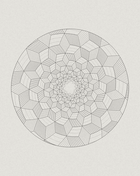
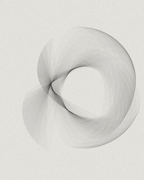
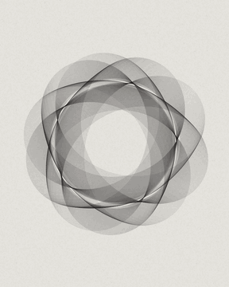
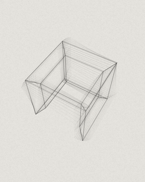
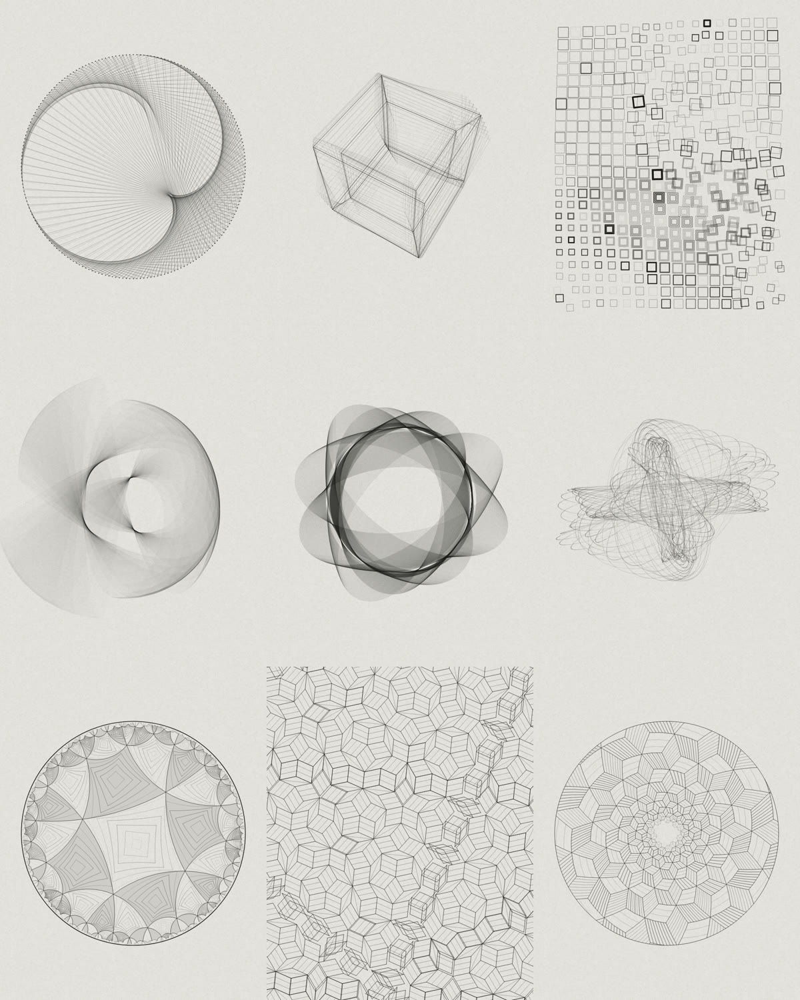

# passer

Animated mathematical drawings in plain Canvas 2D: hairlines on grey paper, in the manner of early plotter art. Every piece is one rule, a few lines of mathematics, drawn live in the browser.

<p align="center">
  
  
  
  
</p>

<sub>The Droste spiral, ribbon sheaf, roulette rosette and tesseract as seamless loops, played two to three times faster than the real thing. A README cannot run JavaScript, so the live pieces are in [the article](https://notes.martijnhermans.nl/generative-abstract-art/).</sub>

*Passer* is the Dutch word for a drawing compass.

- **Fifteen pieces**, each one self-contained HTML file under 31 KB. No dependencies, no network, opens straight from disk.
- **Two clocks.** In loop mode a piece closes exactly at its loop time, which is what exports use. In live mode, the browser default, slow detuned voices and drift mean it never visibly repeats.
- **Deterministic.** Same seed, same drawing.
- **One small shared engine** (`src/genart.js`, a plain ES module): paper and film grain, seeded random numbers, loop noise, three themes (`mono`, `fieldnotes`, `night`), mounting, pausing, a reduced-motion still, and PNG, WebM and frame-sequence export.

How these were made, and what a model on a home server could do with them, is written up in [the article](https://notes.martijnhermans.nl/generative-abstract-art/), where the pieces run live.

## The pieces



| Piece | File | The rule |
|---|---|---|
| Schotter drift | `dist/f01-schotter.html` | A lattice of squares where order and disorder trade places in drifting patches, some squares opening into nested ones, while slow rings of order cross the sheet. |
| Tesseract | `dist/f04-tesseract.html` | A hypercube turning in four dimensions, projected to a fan of fine lines where only a seeded subset of its edges is drawn. |
| Ribbon sheaf | `dist/f06-ribbon-sheaf.html` | One looping curve copied a few hundred times, each copy turned slightly further, so the hairlines build a folded translucent ribbon. |
| Pegs and string | `dist/f10-pegs-string.html` | Pegs on a ring, each joined by a straight thin string to the peg at k times its number, while k sweeps slowly so the glowing envelope curves (cardioid, nephroid and more) bloom and fold into one another. |
| Metamorphosis | `dist/f12-metamorphosis.html` | A sheet of hatched and empty tiles that interlock without gaps and drift sideways; their edge curves change from one shape family to another as they cross the page. |
| Harmonograph | `dist/m01-harmonograph.html` | One closed pen path from four pendulums with near-integer frequency ratios; a periodic amplitude envelope winds the spiral in and out and the ink gathers where the path retraces. |
| Thomas attractor | `dist/m02-clifford.html` | Thousands of hairline filaments flowing along one Thomas strange attractor at a steady, gentle speed, while the damping parameter b drifts slowly so the scroll folds into new shapes inside itself. |
| Chladni figure | `dist/m04-chladni.html` | The standing-wave pattern of a square plate drawn as contours of the displacement, with sand collecting on the lines where the plate stays still while two vibration modes cross-fade. |
| Hyperbolic tiling | `dist/m06-hyperbolic.html` | A regular tiling of the hyperbolic plane drawn in the Poincare disc: triangles or squares shrink toward the rim while a moving Mobius shift makes the whole tiling swim like a fisheye. |
| Apollonian gasket | `dist/m07-apollonian.html` | An Apollonian gasket, the packing of tangent circles generated by Descartes' theorem, swirled by a Mobius map that carries every circle to another exact circle and keeps all tangencies. |
| Penrose phason drift | `dist/m08-penrose.html` | A Penrose rhomb tiling generated from a pentagrid whose lines slowly slide, so tiles flip in place while the pattern stays a perfect Penrose tiling. |
| Roulette rosette | `dist/m09-roulette.html` | A hypotrochoid drawn ninety times, each copy with the pen offset a little larger and the copy turned a little further, so the copies weave moire rosettes. |
| Roos | `dist/v05-roos.html` | One rose r = cos(kt) copied about forty times, each copy smaller, turned a little further and with slimmer petals, so the hairlines build a translucent lotus while k slides between rational values. |
| Droste | `dist/v07-droste.html` | A field of pencil-hatched cubes in three tones, wound into a logarithmic spiral that contains a smaller twisted copy of itself and zooms endlessly inward, after the Droste effect and Escher's Print Gallery. |
| Kubus (origineel) | `dist/v08-kubus.html` | An isometric stack of cubes in a corner, drawn as a pencil tiling of rhombi in three tones; cubes are added and removed one at a time so the heap grows, collapses and builds towers and canyons. |

Also in the repo: `dist/m05-phyllotaxis.html`, a sunflower spiral of fine dots whose divergence angle drifts around the golden angle. It is not one of the fifteen. Pieces that were tried and set aside live in `src/pieces/_parked/`.

## Run it

```sh
node scripts/build.mjs               # src/pieces/<id>.js  ->  dist/<id>.html
open dist/f01-schotter.html          # macOS; elsewhere just double-click the file
python3 -m http.server -d dist       # the stage with a piece picker and speed slider: http://localhost:8000/
```

Node is only needed to build. Each page in `dist/` already contains the engine and its piece.

## URL parameters

Every piece page reads these.

| Parameter | Meaning |
|---|---|
| `seed` | Any string. Default `1`. |
| `theme` | `mono` (default), `fieldnotes` or `night`. |
| `aspect` | Width and height as `w:h`, for example `4:5`, `16:9` or `1:1`. |
| `t` | Seconds. Draws one frozen frame in loop mode. |
| `reduce` | `1` for the reduced-motion still, `0` to animate. |
| `size` | Output size for exports. |
| `export` | `png`, `webm` (a seamless loop, captured in real time) or `frames` (asks for a folder). |
| `p.<name>` | Numeric override of a piece parameter, for example `p.bleed=1` on the Droste spiral. |

## Anatomy of a piece

A piece is a module with two exports. `draw` is pure: the same inputs give the same pixels.

```js
export const meta = {
  id: 'f01-schotter', title: 'Schotter drift',
  T: 16,              // loop length in seconds
  still: 0.56,        // where in the loop the still frame is taken
  aspects: ['4:5', '16:9', '1:1'],
  math: '...',        // the defining equation, one plain line
  label: '...',       // the piece in one sentence
  params: { /* numeric knobs, overridable with ?p.name=value */ },
};

export function draw(ctx, { seed, t, w, h, g }) {
  // g.c colours, g.params, g.rng(name), g.theta (loop phase), g.voice(k),
  // g.loop(x, y, r), g.live and g.drift (live mode), g.hw and g.hh (half the sheet), g.S (scale)
}
```

The full contract is in `src/genart.js`, and the design rules are in `docs/STYLE-SPEC.md`.

## Principles

1. One rule, stated plainly. If a piece cannot be described in one sentence, cut until it can.
2. Order versus disorder is the drama. Randomness is seasoning on a system, never the system.
3. Texture completes the image. A grain-free render is unfinished.
4. Always moving, never repeating. A piece that holds still reads as broken, not calm.
5. Hairlines in quantity. Empty paper is part of the composition.

## Inspiration

Vera Molnár, Georg Nees, Frieder Nake, Manfred Mohr, Charles Csuri and Ruth Leavitt, who made pictures from rules and a little chance on computers and plotters in the 1960s and 70s. Casey Reas, who does it with software, and Dmitri Cherniak, whose wrapped strings are behind the pegs-and-string piece. François Morellet and M.C. Escher, who did it by hand.

## License

[MIT](LICENSE)
